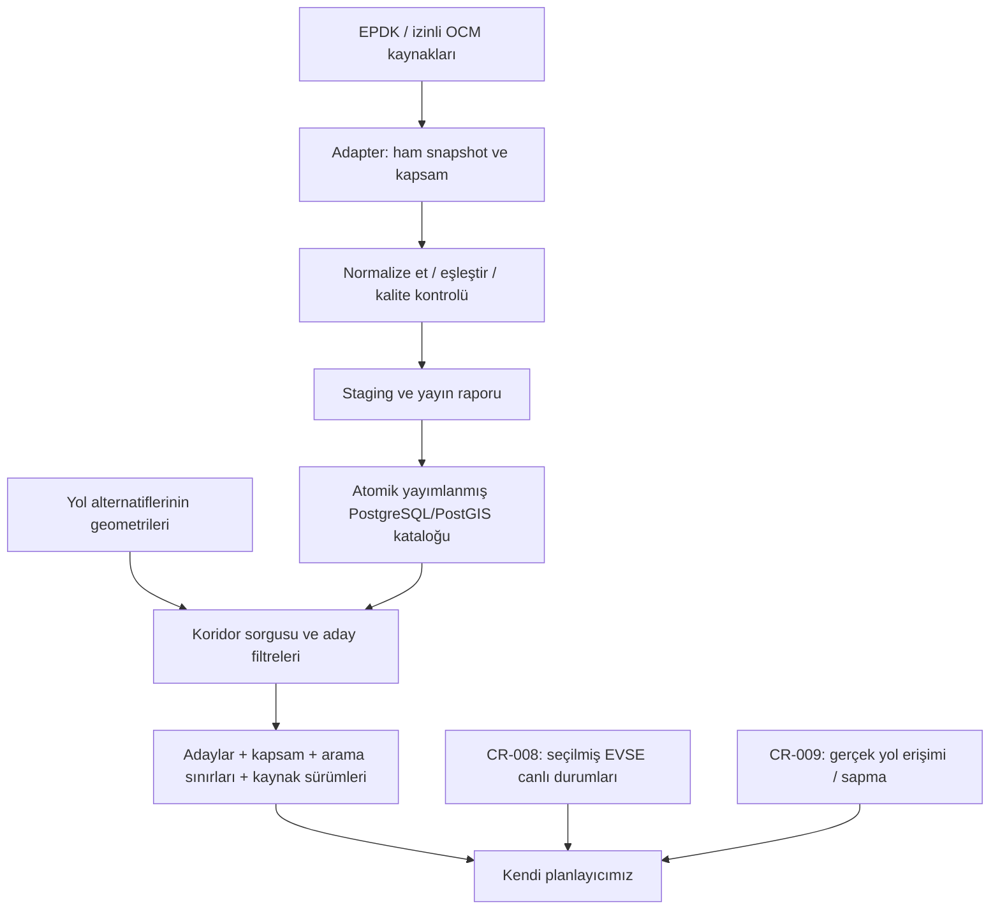

# CR-007 — İstasyon politikaları ve mimari hazırlığı

Tarih: 2026-11-10. Bu belge uygulama öncesi hazırlık kaydıdır. Sonraki kullanıcı talebiyle uygulama tamamlandı: [CR-007 teslimi](STATION_CATALOGUE.md). Sabit pilot güzergâh seçmek yerine kullanıcı konumlarından gelen yol geometrisini kullanma tercihi kabul edildi. Aşağıdaki açık noktaların güncel sonucu teslim belgesindedir.

## 1. Önerilen mimari



CR-007 sorgusu dış HTTP veya import başlatmaz. Harita renderer'ından bağımsız yol geometrisi alır; istasyon seçimi/enerji erişimi/şarj süresini provider kararlaştırmaz. Statik sorgu DB'den, canlı yenileme CR-008'den, yol erişimi CR-009'dan gelir. LLM bağımlılığı eklenmez.

## 2. Kaynak kabul kapısı

İlk teknik adım küçük gerçek cevap örneklerini incelemektir: kaynak kimlikleri ve anlamı, koordinat, ülke/kapsam, sayfalama/tamlık, değişiklik tarihi, erişim/attribution, kota ve silinme davranışı. EPDK ana kaynak tercihi veri kapsamı doğrulanmasına bağlıdır; servis listeleniyor diye bütün EVSE/voltaj/tarife/canlı alanları var sayılmaz. [Resmî servis listesi](https://epdk.gov.tr/Detay/Icerik/3-34680/enerji-donusum-piyasasi-web-servisleri), [EPDK SSS](https://epdk.gov.tr/Detay/Icerik/12-1040/enerji-donusumu).

OCM'de açık veri filtresi ve kayıt başına data-provider/lisans bilgisi korunur; kaynak önceliği izin kontrolünü atlamaz. [OCM rehberi](https://github.com/openchargemap/ocm-docs/blob/master/System/DeveloperGuide.md). Operatör/OCPI desteği, erişim yetkisi veya ücretsiz TR kapsamı demek değildir. Canlı kaynak sözleşmeleri CR-008'de ayrıca doğrulanacak.

## 3. Kimlik ve eşleştirme

Önerilen model `Location → EVSE → Connector` ve bağımsız güç paylaşım grubudur. İç kimlikler kararlı UUID olur. Dış kimlikler kaynak/ülke/işletmeci/lokasyon/EVSE/soket namespace'iyle, ham biçim ve kaynak normalizasyon kuralıyla tutulur. EPDK kodunun lokasyona mı ekipmana mı ait olduğu gerçek şemadan doğrulanır; sayısal görünen ID'lerin baştaki sıfırları silinmez.

Kesin harici kimlik/crosswalk varsa otomatik eşleme; isim/koordinat yakınlığı yalnız eşleme adayı üretir. Aynı işletmeci bile olsa yakın koordinat otomatik birleşme kanıtı değildir. Aynı tesiste farklı işletmeciler ve karşı yön girişi olan noktalar ayrı kalabilir. İsteğe bağlı tesis grubu bunları fiziksel olarak ilişkilendirebilir; güç/kapasite birleştirmez. Birleşme kararının gerekçesi ve sürümü saklanır; eski ID'ler alias olarak çözülür. Kaynak kodu tekrar kullanımı/işletmeci değişimi yaşam döngüsü incelemesi gerektirir.

Alan bazında öncelik: kayıt/tescil kimliği için doğrulanmış EPDK; canlı durum için yetkili doğrudan operatör feed'i; konum/teknik alanlarda kapsam ve güncelliği uygun kaynak. Bu, henüz operatör bağlantısı kurulmuş olduğu anlamına gelmez. EPDK'nin null alanı OCM ile tamamlanabilir, çelişen değer sessizce ezilmez veya ortalanmaz. Büyük koordinat kayması veya çelişkili soket/powerType karantinaya alınır; lat/lon otomatik takas edilmez.

## 4. Kaynak sayımları ve fiziksel kapasite

Kaynak yalnız toplam soket/ünite sayısı verirse bunu `aggregate_claim` olarak sakla. On adet soket beyanından on gerçek EVSE kimliği uydurma. İki soketi olan EVSE'nin aynı anda iki araç şarj ettiği varsayılmaz. EVSE, connector ve paylaşılan saha gücü ayrı tutulur; ilan edilen güçler toplanarak eşzamanlı kapasite oluşturulmaz.

Kaynağı yeterli olmayan lokasyon haritada gösterilebilir. Ancak gerçek EVSE/uyumluluk/enerji verisi olmadan planın zorunlu şarj durağı olarak güvenle kullanıldığı iddia edilmez. Mevcut domain EVSE listesi boş lokasyona izin veriyor; aggregate beyan için ayrı kanıt alanı gerekir. Voltaj/akım bilinmiyorsa nominal 800 V araç veya istasyonun tepe kW etiketiyle fiziksel şarj gücü atanmaz.

## 5. Yaşam döngüsü, erişim ve canlı durum

Üç ayrı boyut öneriliyor:

- Yaşam döngüsü: planlanan/işletimde/geçici kapalı/kaldırılmış/bilinmiyor.
- Erişim: halka açıklık, üyelik/ödeme şartı, saatler, giriş/erişim kısıtları.
- Canlı durum: müsait/dolu/rezerve/engelli/arızalı/bilinmiyor; EVSE seviyesinde, kaynak gözlem ve alınma zamanı ayrı.

Known-private veya kaldırılmış/henüz açılmamış ekipman varsayılan rota adayı değildir. Üyelik gerekliliği istasyonu otomatik yasaklamaz; kullanıcı erişim tercihine göre değerlendirilir ve şart belirtilir. Erişim veya saat bilinmiyorsa açık olduğu iddia edilmez. Harita görünürlüğü ve rota uygunluğu ayrı kalır.

Kabul edilen müsaitlik politikası: unknown uyarıyla aday, güncel arızalı/erişilemez EVSE dışarıda. Dolu gözlemi kalıcı erişilemezlik sayılmaz; varış zamanı/bekleme/risk politikası CR-008/013'te ayrıca ele alınır. Statik import zamanı canlı gözlem zamanını yenilemez. Source-observed zamanı bilinmeyen/eski durum otomatik available olmaz. Eski arıza gözlemi ile kalıcı kaldırılma aynı TTL mantığına sokulmaz. Şimdiki müsaitlik varış anı garantisi değildir. OCPI yaşam döngüsünde `REMOVED` ayrıca tanımlıdır: [Locations](https://github.com/ocpi/ocpi/blob/2.3.0/release/core/mod_locations.asciidoc).

## 6. PostGIS ve aday bütçesi

Öneri: lokasyonda `geography(Point,4326)` + uygun GiST; sorguda yol çizgisi boyunca `ST_DWithin(..., metre)`. Aynı tür/indeks kullanılmalı; her satırı farklı geometri türüne çevirerek indeks etkisizleştirilmemeli. [PostGIS](https://postgis.net/docs/ST_DWithin.html).

Yalnız birkaç rota koordinatı çevresinde en yakın K istasyon aranmaz. Uzun geometri parçalara ayrılırsa sınır boşlukları önlenir, sonuçlar iç kimlikte tekilleştirilir. Her adayın rota alternatifi, kesimi ve yaklaşık ilerleme bilgisi korunur; coğrafi yakınlık gerçek sapma süresi değildir. Yanlış yöndeki yol/kapalı kavşak/giriş erişimi CR-009'da doğrulanır.

Uyumlu aday sayısı yetersizse koridor kontrollü genişler. İlk/genişletilmiş yarıçap, geometri boyutu, aday/iterasyon/deadline sınırları sürümlü sunucu politikasıdır. Örnek birkaç km değerleri gerçek pilot testinden önce kabul edilmiş eşik değildir. Güç tercihiyle yavaş ama tek erişilebilir istasyon sessizce elenmez. Hard kısıtlar ile sıralama tercihleri ayrılır.

Sonuç sayısı/bütçe nedeniyle erken kesildiyse bunu bildir; `no_route` veya küresel optimum iddiası üretme. Harita pagination'ı ile planlayıcı aday tamlığı aynı şey değildir. Durak seçimi, şarj hedefi ve rezerv CR-013'te kalır.

## 7. Port değişikliği: listenin yanında kapsam

Mevcut `StationDataProvider.findAlongRoutes` yalnız `ChargingStation[]` döndürüyor. CR-007'de önerilen normalize sonuç:

```text
StationCandidateSet
  candidates: istasyon + rota/kesim ilişkileri + kalite/uyumluluk notları
  coverage: kaynak, coğrafi kapsam, son başarılı kontrol, snapshot tamlığı
  search: koridor, politika sürümü, truncated, gerekçe, devam/genişletme bilgisi
  revisions: kullanılan statik veri sürümleri ve checksum'lar
```

Tam kaynak snapshot'ı, veritabanının sorgulanan bölgeyi kapsaması ve sınırlanmamış aday araması ayrı boyutlardır. Kaynağın bütün sayfalarının alınması fiziksel dünyadaki bütün istasyonların bilindiğini kanıtlamaz. Boş sonuç; bilinen veri kapsamında eşleşme yok, bölge yüklenmemiş veya arama sınırlı olarak ayrılır. Sağlayıcı hatası boş array'e dönüştürülmez.

Coordinator/PlanningInput/evaluation ve CR-005 fixture'ları birlikte güncellenir. Eksik katalogdan kesin ulaşılamazlık çıkarılmaz. Bir plan hesaplanabilse bile sınırlı veriyle optimum/eksiksiz alternatif garantisi verilmez. Kaynak, kapsam ve veri yaşı gelecekteki plan snapshot'ına taşınır.

## 8. Önerilen DB sınırları

| Yapı | Amaç |
|---|---|
| station_data_sources / snapshots / import_runs | İzin/atıf, ham veri, checksum, sayfalama/checkpoint, tamlık ve kalite raporu |
| charging_locations + source_aliases | Kaynaktan bağımsız lokasyon kimliği, koordinat ve dış kimlik eşleştirmesi |
| charging_evses / connectors / power_pools | Gerçek ekipman ve elektriksel sınırlar; aggregate beyanlardan ayrı |
| station_field_evidence / matching_reviews | Alan bazında dayanak, çelişki, eşleştirme/ayırma gerekçeleri |
| station_catalogue_revisions / publications | Değişmez statik revizyonlar ve atomik aktif yayın |
| station_coverage | Kaynak/bölge kapsamında son başarılı ve tamamlanmış alım bilgisi |
| availability_observations / latest state | CR-008'in sıcak durumu; statik katalogdan bağımsız zaman sırası |

İsimler mantıksaldır; kaynak örneği ve sorgu denemesi sonrası fiziksel DDL netleşecek. Araçlara ait `vehicle_data_sources` istasyon tablosuna dönüştürülmez; ortak kaynak/checksum araçları paylaşılabilir. Büyük ham JSON katalog listesinde taşınmaz. Yayınlanmış lokasyon görünümü + toplu ekipman okuması N+1'i önler. Statik ve canlı güncellemeler bütün katalog JSON'unu sürekli yeniden yazmaz.

Kaynak download/parse dışarıda; staging batch; yayın pointer'ı kısa transaction. Eksik sayfa/kota/timeout tam snapshot sayılmaz. Silme yalnız açık tombstone veya tamamlığı doğrulanmış kaynak kapsamı kuralıyla yapılır; kaynak A'dan kaybolan kayıt kaynak B'den gelen varlığı yok etmez. Eski statik revizyonlar plan geçmişini korur. Noktasal güncelleme ile bütün ülke yayını için ayrı kapsam anahtarları gerekir.

## 9. Güncelleme, Redis ve işletim

CR-007'de manuel CLI/import ve tekrar kullanılabilir servis. Periyodik güvenilir yürütüm CR-021'de; istasyonlar için haftalık araç job'u körlemesine kopyalanmaz. Statik katalog destek varsa artımlı güncellenir, periyodik tam uzlaştırma ayrı yapılır. Sayfalama sırasında veri değişimi için bounded watermark/tekrar alım ve idempotency gerekir; ayrıntı kaynak kabiliyetine bağlı.

CR-008'de yalnız anlamlı aday/durak/yedek EVSE'lerin durumu yenilenir. Kaynak başına kota, sınırlı eşzamanlılık, backoff, circuit breaker ve aynı isteği tekilleştirme gerekir. Çok instance'ta in-memory kilit yeterli değildir; mevcut PostgreSQL ile süreli lease ve eski işçinin yeni durumu ezmesini önleyen sürüm/fencing önerilir. Redis ileride adapter olabilir; şimdi yeni servis şart değil.

Statik TTL, canlı TTL, azami backoff, koridor yarıçapları, aday üst sınırı ve API p95/p99 hedefi henüz seçilmedi. Sayılar kaynak kotası/frekansı, gerçek örnek ve pilot yük denemesinden sonra politika sürümüyle atanır. Geçmişteki rate-limit koruması korunur; provider kotası ile kullanıcı rate limiti birbirinin yerine geçmez.

## 10. Uygulama sırası ve kabul kapıları

1. EPDK küçük örnek + veri sözlüğü/kullanım/kota incelemesi; OCM yetenek/atıf matrisi. Erişim açığı varsa açık rapor, sessiz kaynak değişimi yok.
2. Kimlik, aggregate beyan, yaşam döngüsü ve kapsam sözleşmeleri; istasyon portu ve coordinator/fixture uyumu.
3. Migration, kaynak staging ve eşleştirme; bilinmeyen EVSE kimlikleri üretilmez.
4. Atomik katalog yayını; tekrar import, eski snapshot, kısmi sayfa ve kaldırma testleri.
5. PostGIS koridor sorgusu, kontrollü genişleme ve sınırlı arama bilgisi.
6. Pilot koridorun iki yönünde karşı şerit/giriş ayrımı ve kaynak kayıt kontrolü. Gerçek yol erişimi CR-009 bağımlılığı olarak açık; bu aşamada sentetik geometri ve elle incelenen adaylarla test edilebilir.
7. Gerçek PostgreSQL/PostGIS üzerinde EXPLAIN/indeks kullanımı, p95/p99, DB pool ve yayın sürerken okuyucu davranışı; izinli üretici API'sine yük bindirmeden yerel fixture yükü.

DONE için kaynak adapter'ı/izinli gerçek örnekler, kimlik/sayfa/tamlık kuralları, indeksli koridor ve hata ayrımı doğrulanmalı. Salt şema veya sahte istasyonlar Türkiye verisi aktarılmış sayılmaz. Task 6'nın pilot enerji açıkları Task 7 altyapısını durdurmaz; tam EV rota doğrulaması bu açıkları ve CR-009/011–013'ü bekler.

## Açık kalan seçimler

- Pilot koridorun başlangıç/bitişi ve test edilecek iki yönü.
- Gerçek EPDK yanıtı ve kaynak kullanım koşulları; OCM'nin dolduracağı alanlar.
- Ölçüme göre sayısal koridor/bütçe/tazelik/performans politikası.

Bu belge uygulama izni veya servis kurulumu değildir; kullanıcının üç kabul edilmiş tercihi ADR-005'te, diğer ayrıntılar öneri olarak ayrılmıştır.
