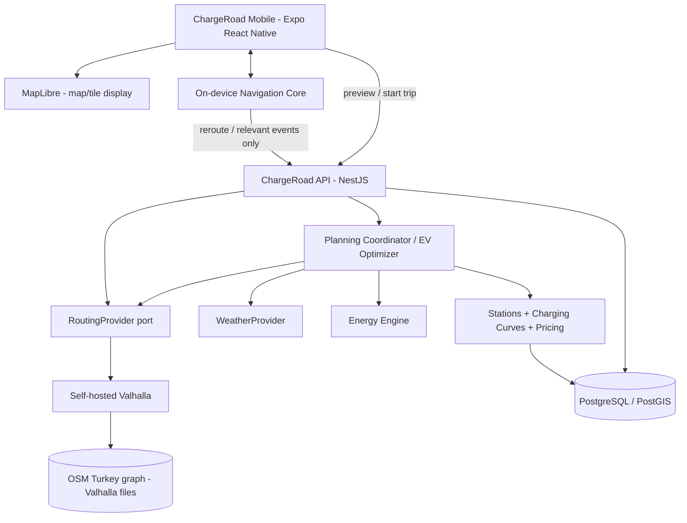

# ADR-009 — ChargeRoad Uygulama İçi Navigasyon ve Açık Kaynak Rotalama Mimarisi

- **Tarih:** 2026-11-12
- **Revizyon:** 2026-11-12 — yerel Valhalla/DEM pilot kanıtları ve sonraki uygulama dilimi
- **Durum:** ACCEPTED — mimari karar; **yerel self-hosted Türkiye Valhalla + DEM PoC çalıştı**; tekrarlanabilir repo/CI, kalıcı kalite kontrolleri, saha ve üretim kabulü **açık**
- **Proje:** `ucartalha/ChargeRoad`
- **Hedef repo yolu:** `docs/adr/009-in-app-navigation-and-self-hosted-routing.md`
- **İlgili görevler:** CR-009, CR-011–014, CR-016–019, CR-021–022; V1-ROAD-001–006
- **İlgili belgeler:** `docs/adr/007-road-provider-pilot.md`, `docs/adr/008-weather-provider-and-planning-policy.md`, `docs/ROAD_PROVIDERS.md`, `docs/ROUTING_ENGINE.md`, `docs/PRODUCT_SCOPE.md`, `docs/V1_RELEASE_BACKLOG.md`, `docs/tasks/valhalla-dem-integration-hardening.md` (önerilen yeni görev dosyası)
- **Karar sahibi:** Ürün sahibi

> **Codex için talimat:** Bu belge uygulanacak mimari kararı ve teslimat ölçütlerini tanımlar. **Önce mevcut kodu ve testleri incele; sonra fark analizi, uygulanabilir küçük değişiklikler ve testlerle ilerle.** Açık kaynak ürünün özelliklerini veya API parametrelerini ilgili sürüm dokümantasyonunda doğrulamadan varsayma. Bu ADR'nin `ACCEPTED` olması CR-016/019'un veya üretim navigasyonunun tamamlandığı anlamına gelmez. Kod/harita sağlayıcısı/gerçek Türkiye cihaz testleri olmadan `DONE` yazma.

---

## 1. Bağlam ve problem

ChargeRoad, elektrikli araç sürücüsünün **başlangıç ve varış seçimi, rota önizleme, alternatif yollar, uygulama içi navigasyon, dinamik batarya tahmini, şarj planlaması ve maliyet hesabını** tek mobil uygulamada gerçekleştirecektir. Kullanıcı Google Maps, Waze veya başka bir navigasyon uygulamasına gönderilmeyecektir.

Temel kısıtlar:

1. **Bütçe öncelikli:** Rota başına ücret, kullanıcının sürekli konum takibi veya her ekran yenilemesiyle büyümemeli.
2. **İçeride tam deneyim:** Harita, rota çizgisi, sürüş talimatları, GPS takip, yeniden rota, şarj/SOC/maliyet ekranları ChargeRoad'da çalışmalı.
3. **Açık kaynak ve sağlayıcı bağımsızlığı:** Açık kaynak OSM tabanlı teknolojilerden yararlan; yeniden yazılması gerekmeyen yol grafı algoritmalarını sıfırdan geliştirme.
4. **Gerçekçilik:** Canlı trafik, güncel otoyol geçiş ücreti, tüm yol hız sınırları ve gerçek araç SOC telemetrisi otomatik olarak mevcut varsayılmayacak.
5. **Veri güvenliği:** Kişisel GPS geçmişi ile paylaşılan yol verisi/cache birbirinden ayrılacak.

### Mevcut repo durumu — kontrol edilecek başlangıç kanıtı

2026-11-12'de incelenen `main` dalında:

- `apps/api/src/roads/valhalla-adapter.ts`: Valhalla `/route` ve `/trace_attributes` ile yol/şekil/manevra elde etme.
- `apps/api/src/roads/road-service.ts`: RoutingProvider, alternatifler, normalize etme, istasyon erişim/sapma sorguları.
- `apps/api/src/roads/road-client.ts`: PostgreSQL paylaşımlı HTTP response cache, lease/fencing ve harici sağlayıcı bütçesi.
- `apps/api/src/roads/road-policy.ts`: pilot varsayılanı **kamu Valhalla demo endpoint'i**; `production` ortamında bu demo bağımlılığı yasak.
- `apps/api/src/roads/normalize-road.ts`: çok sayıda enerji hesabı kesimi üretir; hız `travel_time_average`, yükseklik kaynağı ayrıca doğrulanmalı.
- `apps/api/src/app.module.ts`: `RoadsModule`, `WeatherModule`, `EnergyModule` var; `PlanningModule` henüz import edilmemiş.
- `apps/api/src/planning/planning-engine.ts`: soyut planlama motoru; tamamlanmış üretim orkestrasyonu varsayılmayacak.
- `apps/mobile/App.tsx`: araç ve başlangıç SOC girişi var; tamamlanmış mobil harita/navigasyon akışı yok.
- `apps/mobile/package.json`: Expo 58 / React Native 0.88; harita SDK entegrasyonu ayrıca doğrulanacak.
- `docs/validation/task9-road-validation.json`: Ankara pilotunda rota üretimi başarılı; **sayısal hız sınırı kapsamı 0 m**. Bu, yol bilgisi kalitesinin V1 için bütünüyle doğrulandığı anlamına gelmez.

Her geliştirme başlamadan önce bu bulguları güncel `main` üzerinde yeniden doğrula; değişmiş olanları gerçek duruma göre düzelt.

### 1.1. 2026-11-12 yerel PoC ilerleme kaydı — doğrulama düzeylerini karıştırma

Bu alt bölüm, Windows PowerShell / Docker Desktop üzerinde **kullanıcının paylaştığı canlı terminal sonuçlarını** ve GitHub `main` üzerindeki **kod incelemesini** ayırır. Yerel çalıştırmanın başarılı olması repoda commit/CI/üretim kabulü anlamına gelmez.

| Kalem | Kanıt ve gözlenen durum | Statü |
| --- | --- | --- |
| Türkiye OSM yol grafı, Valhalla 3.9.1 | `ghcr.io/valhalla/valhalla-scripted:3.9.1`; yerelde `/route` yanıtı | **Yerel PoC başarılı** |
| Mevcut örneğin ayrımı | `chargeroad-valhalla` → host `127.0.0.1:8002` (elevation kapalı); `chargeroad-valhalla-elevation` → host `127.0.0.1:8003` (elevation açık) | **İki ayrı runtime; kalıcı tek kurulum henüz değil** |
| DEM dosyaları | `infra/valhalla/elevation-pilot/elevation_data` altında yerel yaklaşık 2 GB HGT (ör. `N39E032.hgt`), `build_elevation=True` | **Yerelde var; kaynak/lisans/sürüm manifesti açık** |
| Valhalla yükseklik | 8003 `/height` gerçek sayısal değer verdi; 8002 rotasında `-500` benzeri geçersiz yer tutucu gözlendi | **Düzeltme gerektiriyor; sentinel politikası henüz kesinleşmedi** |
| API entegrasyonu | Windows'taki NestJS **3001** `/v1/ready` → `status: ok`, `database: ready`; `ROAD_ROUTING_BASE_URL=http://127.0.0.1:8003`; rota kaynağı gerçekten 8003 | **Yerel API testi başarılı** |
| API çalışan örnekleri | Yerel önceki API **3000**, yeni test API'si **3001**; her ikisi de aynı PostgreSQL'i kullanabilir | **Port/DB bütçesi izolasyonu açık** |
| Rota profili | 39.900000,32.800000 → 39.910000,32.800000; **4.407 km**, **72 normalize kesim**, **229 kesimler arası tekrarlı yükseklik öğesi**, **0 adet `<= -499` gözlemi**; yükseklik min 868.1 m, max 911.2 m | **Tek yerel örnekte başarılı** |
| Ham Valhalla örneklemesi | 30 m istek: **148** yükseklik noktası; aynı güzergâhta 300 m istek: **16** nokta, min 868.7 m, max 909.0 m | **Test edildi; farklı örnekleme aralıkları karşılaştırıldı** |
| Yükselme/iniş | **+92.3 m / -109.9 m**; rota segment başlangıcı 909 m, sonu 891.4 m; net **-17.6 m**; `(gain-loss)-(end-start)=0.0 m` | **İç aritmetik tutarlı; fiziksel doğruluk kanıtı değil** |
| Rakım dış karşılaştırması | OpenTopoData `srtm30m` A=905 m, B=890 m; yerel Valhalla `/height` A=905 m, B=890 m | **Tam eşleşme; iki kaynak aynı SRTM verisine dayanabilir** |
| Eğim QA | 30 m kesimde -%31.3; 150 m hareketli pencerede -%15.5; 300 m pencerede gözlenen en yüksek mutlak değer %7.03 | **Anomali/ölçek analizi yapıldı; yol yüzeyi bağımsız doğrulanmadı** |
| Rota farkı referansları | Standart Valhalla **4.407 km / 7.72 dk**; Valhalla `shortest` **2.429 km / 7.36 dk**; demo OSRM **2.545 km / 4.16 dk**; Google Haritalar manuel seçenekler **yaklaşık 3.2–5 km** | **Karşılaştırma gözlemi; motorlar aynı geometri/başlangıç snap'ini kullanmayabilir** |
| Kalıcı `elevationQuality` | GitHub `main` `normalize-road.ts` henüz `RoadSegment.elevationQuality` set etmiyor; `EnergyConsumptionEngine` bunu kontrol ediyor | **Kod açığı; yerelde geçici düzenleme yapılmış olabilir, commit kanıtı yok** |
| Tekrarlanabilir kurulum | `infra/valhalla/compose.yaml` ve `elevation-pilot` yerelde görüldü; incelenen GitHub `main` dosya ağacında `infra/valhalla` **ve ADR-009 henüz yok** | **Versiyon kontrolüne uygun altyapı/runbook gerekiyor** |
| Production / mobile | Harita/turn-by-turn, saha GPS, üretim servisi, graf güncelleme, ölçülmüş kapasite **doğrulanmadı** | **Açık** |

**Önemli yorumlar:**

- `229` sayısı **benzersiz DEM noktası** değildir; kesim sınırlarında profil örnekleri tekrar eder. `72` **yol/topoloji ve eğim politikasına göre normalize kesim** sayısıdır; 30 m veri çözünürlüğü ile bire bir aynı kavram değildir.
- SRTM iki uç noktada **905 → 890 m** verirken seçilen sürüş rotasının segment sınırlarında **909 → 891.4 m** vermesi tek başına çelişki değildir: route snap/yol eşleme, farklı yol geometri konumları ve örnekleme farkları incelenmelidir.
- Aynı / benzer DEM veri ürününden gelen `0 m` farklı değerler **bağımsız arazi veya yol kotu doğrulaması** sayılmaz. `elevationQuality='verified'` yalnız bu kıyasa dayanarak atanamaz.
- Kullanıcının manuel Google Haritalar gözlemi **3.2–5 km** aralığındadır. OSRM veya Valhalla'dan birinin "kesin doğru rota" olduğu sonucuna varılmayacak. Rota tercihleri ve EV optimizasyonu **ayrı sonraki iş**.
- Yerel runtime'ta `ROAD_ROUTING_DAILY_REQUEST_LIMIT=1000` ayarı kullanıldı; GitHub `main` `road-policy.ts` ise **sabit 100/gün** kullanıyor. `road_provider_budget` aynı `providerId` ile aynı DB'yi paylaşır: 3000 ve 3001 birbirinden bağımsız limit sanılmamalı. Üretim için keyfi limit yükseltme yapılmayacak.

### 1.2. Bu revizyondaki **sıradaki uygulama dilimi**

`docs/tasks/valhalla-dem-integration-hardening.md` görevi (aşağıda ekli dosya) **P1'in yerel pilotunu koruyup sağlamlaştırmaya** odaklanır:

1. Repo/çalışan Windows ortamını, `.env` ve iki Valhalla örneğini **bozmadan** denetle.
2. DEM'li self-hosted Valhalla'yı tekrar oluşturulabilir, versiyonlu, sağlık kontrolü olan geliştirme kurulumu ve operasyon runbook'u haline getir.
3. Eksik/yer tutucu/negatif rakım ve `modelled / unknown / verified` sınıflandırmasını enerji sözleşmesine uygun, testli hale getir.
4. **30 m ham DEM + 300 m mesafe bazlı hareketli eğim analizi** tasarla ve test et. 300 m'yi tüm yol kesimleri için minimum olarak zorlama; otomatik rastgele yumuşatma veya hard cap uygulama.
5. Kaynak/önbellek graf sürümü, self-hosted iç kapasite koruması ile harici API kredi kotasını ayırma konularını gözden geçir; gerekli asgari güvenli düzeltmeleri uygula.
6. Tek komutlu/deterministik rota ve veri kalitesi doğrulama raporu üret; gerçek saha doğrulaması olmayan maddeleri açık bırak.

**Bu işin dışında:** `fastest/shortest/EV-optimum` aday üretimi ve sıralaması, `use_distance` tuning, mobil MapLibre, GPS turn-by-turn, ücret/şarj optimizasyonu, tüm Türkiye benchmark'ı ve production release. Bunları bu göreve ekleme.

---

## 2. Kabul edilen ana kararlar

### DEC-009-A — Navigasyon tamamen uygulama içinde

- Mobil kullanıcı **hiçbir aşamada harici navigasyon uygulamasına gönderilmeyecek**.
- Rota çizimi, başlangıç/varış ve waypoint seçimi, seyahat başlat/duraklat/bitir, aktif takip, dönüşe kalan mesafe, sesli yönlendirme, rota sapması ve yeniden planlama ChargeRoad'un arayüzünde bulunacak.
- Native mobil platformun konum/izin/arka plan ve metinden sese yetenekleri kullanılabilir; **başka markanın navigasyon ekranı** uygulama içi deneyimin yerine geçmez.
- CarPlay/Android Auto ve tamamen çevrimdışı yol hesaplama ilk V1 kapsamı dışında; çevrimdışı mevcut rotayı görüntüleme/izleme davranışı ayrıca tasarlanacak.

### DEC-009-B — Yol grafını sıfırdan yazmıyoruz: Self-hosted Valhalla

- Yol bulma ve yol üzerindeki manevralar için **açık kaynak Valhalla** kullanılacak.
- Üretim hedefi Türkiye OSM yol ağı ile **kendi barındırdığımız Valhalla servisi**.
- Kaynak veri: Türkiye OpenStreetMap verisi (`.osm.pbf`), örn. Geofabrik. İndirme, güncelleme, lisans/atıf, graf üretimi ve işletim otomatikleştirilecek.
- Başka rota motorları (OSRM, GraphHopper) alternatif olarak değerlendirilebilir; **benchmark veya kanıt olmadan ikinci motor eklenmeyecek**.
- Sıfırdan Dijkstra/A*/CH, turn restriction, map matching gibi yol bulma altyapısı geliştirmek kapsam dışı.
- Kendi işimiz: **EV rotası puanlama/optimizasyon, SOC, şarj, maliyet, GPS ilerleme ve navigasyon durumu**.

### DEC-009-C — Sağlayıcı değiştirilebilir, varsayılan üretim bağımsız

- Mevcut `RoutingProvider` portu ve `RoadShapeAdapter` altyapısı korunacak.
- İlk adapter Valhalla; production endpoint kendi barındırılan servise işaret edecek.
- Geoapify **zorunlu bağımlılık değil**; pilot, A/B karşılaştırması veya şartları doğrulanmış opsiyonel fallback olarak değerlendirilebilir. Pilot kabulü yapılmadan üretime eklenmez.
- Google/HERE/başka ücretli servis zorunlu kılınmayacak; ödeme gerektiren fallback veya otomatik ücretli kota aşımı **varsayılan olarak kapalı** olacak.
- Sağlayıcıdan gelen her sonuçta kaynak, veri yaşı, yol/ETA/speed/elevation kalitesi ve varsa trafik modeli gösterilecek.

### DEC-009-D — Harita görüntüleme rota motorundan ayrı

- React Native için **MapLibre** tabanlı vektör harita görüntüleme hedeflenir.
- V1 pilotunda ticari kullanım/attribution/erişim koşulları doğrulandığı ölçüde **OpenFreeMap** gibi düşük maliyetli tile servisi kullanılabilir.
- Kamu tile servisinin erişimi veya ücretsizliği üretim SLA sayılmaz. Kullanım ölçeği büyüdüğünde self-hosted tiles veya sözleşmeli sağlayıcı opsiyonu korunur.
- **OSM kamu tile sunucularını**, Nominatim halka açık endpoint'ini veya kamu Valhalla demo servisini sınırsız üretim altyapısı olarak kullanma.
- MapLibre **rota hesaplamaz**; sadece haritayı, katmanları, rota çizgilerini ve kullanıcı konumunu görüntüler.
- Expo 58 / RN 0.88 ile MapLibre native modül uyumluluğu ve development build/EAS gereksinimi **PoC ile doğrulanacak**. Expo Go'ya bağımlı çözüm planlama.

### DEC-009-E — Rota seçenekleri: hızlı, kısa, ücretsiz, EV-optimum

- Kullanıcı için hedef seçenekler: `fastest`, `shortest`, `avoid_tolls`, `avoid_ferries`, ileride `ev_optimized` ve `lowest_total_cost`.
- Bunlar hem mobil kullanıcı niyeti hem sunucu taraftaki doğrulanabilir route policy olarak modellenmeli.
- Valhalla sürümünün desteklediği `shortest`, `exclude_tolls`, `exclude_ferries` vb. seçenekleri **kurulu sürümde doğrula**. Bir `use_tolls=0` tercihini "ücretli yol kesin yasak" kabul etme.
- Ücretli yol kaçınması imkânsızsa veya sağlayıcıdan kesin doğrulama alınamıyorsa, sonuç **kullanıcı tercihi karşılandı** şeklinde işaretlenmeyecek.
- `en hızlı` ile `en kısa` aynı şey değildir; süre/manevra/mesafe kriterleri testlerde ayrılacak.
- Yol ağı sağlayıcısı alternatif yol adaylarını üretir; **EV enerji/şarj/maliyet açısından nihai aday sıralamasını ChargeRoad** yapar.
- Alternatif aday kümesi sınırlı olacağından, bulunan `EV-optimum` sonucunun **küresel matematiksel optimum** olduğu iddia edilmeyecek; kalite ve sınırlar raporlanacak.

### DEC-009-F — Navigasyon sırasında GPS cihazda işlenir

- Konum güncellemeleri **doğrudan rota sağlayıcısı çağrısına dönüşmeyecek**.
- Mobil navigasyon çekirdeği: konum/güvenilirlik filtreleme, yol üzeri projeksiyon (snap/map matching), rota ilerlemesi, sıradaki manevra, turn-by-turn UI, reroute tetikleme, lokal sesli yönlendirme.
- Önerilen ilk yaklaşım: backend'den gelen eşlenmiş rota geometrisine telefon tarafında projeksiyon; belirsiz durum/karmaşık yol ayrımlarında açık kaynak harita eşleme stratejisini test et. GPS tek örneğinden hatalı yol değişimi yapma.
- GPS gürültüsü/çoklu sapma örneği/mesafe-süre eşiği ile **hysteresis** uygula; konum her saptığında yeni HTTP isteği üretme.
- Bağlantı kesildiğinde mevcut rota, sonraki manevra ve **son bilinen veriyle oluşturulan tahminin güncellik durumu** görüntülenebilmeli. İnternet yokken yeni yol hesaplama yeteneği V1'de zorunlu değil.
- Arka plan GPS, uygulama kapatma/yeniden açma, Android/iOS izinleri, pil ve sesli talimatlar **fiziksel cihazda** doğrulanacak.

### DEC-009-G — EV algoritmaları uygulama sahibinde

- `RoadRoutingService`: yol/geometri/manevra, fiziksel yolculuk süresi, seçenek ve kaynak metadatası.
- `WeatherProvider`: yol kesiminin konumuna ve tahmini geçiş saatine göre hava serisi; şarj bekleme değişirse ETA düzeltmesi.
- `EnergyEngine`: varyant, hız profili, eğim, rüzgâr yönü, sıcaklık, HVAC, sürüş ve yük varsayımlarıyla kWh/SOC tahmini.
- `ChargingCurve/EVSE`: gerçek araç varyantı, SOC aralığı, şarj gücü, batarya sıcaklığı/preconditioning varsayımı ve şarj süresi.
- `ChargingStopOptimizer`: sapma dahil toplam yolculuk süresi veya seçilen maliyet hedefi, menzil/rezerv kısıtları ve fiziksel erişim.
- `TripCost`: enerji bedeli, ücretli yollar/köprüler (ayrı güvenilir tarife kaynağından), varsa park/diğer ücretler; **kaynak ve güncellik** gösterilmeden sayısal geçiş ücreti uydurma.
- Navigasyon ekranında `SOC (estimated)` ile `SOC (measured/user_input)` kesin şekilde ayrılacak; araç telemetrisi varmış gibi gösterilmeyecek.
- Gerçek fiyat/istasyon durumları canlı ve doğrulanmış değilse `unknown`, `stale` veya uygun kaynak durumuyla etiketlenecek.

### DEC-009-H — Önizleme ile navigasyon aynı ayrıntıda çalışmaz

- Rota önizlemesi: hızlı ve düşük maliyetli yol + yaklaşık EV planı.
- Navigasyon: yalnızca gerekli ileri kesimlerde daha ayrıntılı hava/SOC hesaplaması, olay bazlı güncelleme.
- Önceki hava tasarımına uyumlu başlangıç hedefi: önizlemede **5 mesafe bölümü**, 150 km ve altında aktif navigasyonda **10 km hava çözünürlüğü**, ileri **40–50 km pencere**. Bu değerler **ayrı policy ve testlerle uygulanacak**, mevcut kodda varmış gibi gösterilmeyecek.
- Kritik rezerv durumunda düşük çözünürlüklü önizleme, doğrulanmış şarj planı değildir. Meteoroloji verisi eksikse ADR-008'in `preliminary / insufficient data` politikası korunacak.
- ETA/SOC/şarj molası değişikliğinde önce cache'teki zaman serileri tekrar hesaplanır; her hesaplama yeni dış HTTP çağrısı gerektirmez.

---

## 3. Hedef bileşen mimarisi

**Teknik sınır:** `Valhalla` yol grafının sahibidir; `ChargeRoad` navigasyon/trip durumunun, enerji ve fiyat hesabının sahibidir. MapLibre sunucudan dönen çizgi/segmentleri sadece gösterir. PostgreSQL yol grafının kendisi yerine istasyon, katalog, kullanıcı, oturum, plan ve cache verilerini yönetir.

### 3.1 Mobil modüller (önerilen sorumluluklar)

- `MapScreen / NavigationScreen`: harita çizimi, route polyline, işaretçiler, manevra banner'ı, alt bilgi panelleri.
- `NavigationSession`: `idle -> preview -> ready -> navigating -> paused -> arrived/cancelled` durum geçişleri, sürüm/oturum kimliği.
- `LocationTracker`: platform GPS event'leri, timestamp/accuracy/speed, izin ve foreground/background lifecycle.
- `RouteProgressTracker`: route'a mesafe projeksiyonu, segment kimliği, kalan mesafe, ETA, sıradaki manevra.
- `ReroutePolicy`: GPS noise ve gerçek sapmayı ayırma; debounce, cooldown, concurrent reroute cancellation.
- `VoiceGuidance`: dil seçenekleri, tekrar eden/çakışan manevra okumalarını önleme, ses önceliği.
- `TripDashboard`: tahmini/mevcut SOC, enerji, istasyon durumu, şarj planı ve maliyet, kaynak/yaş göstergeleri.

Bu isimler öneridir. Mevcut klasör yapısını incele; gereksiz katman veya yeni framework ekleme.

### 3.2 Backend sınırları

- `RoadsModule / RoutingProvider`: gerçek yol kandidatı, manevra, geometri, rota maliyet tercihi, kaynak.
- `PlanningModule`: rota adaylarına araç/şarj/hava kısıtları uygular; seçim ve plan sürümü.
- `Trips/Navigation orchestration` (mevcut modüllere uygun): oturum, asenkron planlama, event sıralaması, aktif/iptal edilmiş işleri yönetir.
- `Stations`: koridor adayları, gerçek yol sapması, erişim durumu.
- `Weather`: ortak coğrafi cache ve geçiş zamanına uygun tahmin.
- `Security/Observability`: kota, IP/kullanıcı veri sınırları, log maskeleme ve metrik.

`PlanningModule`'ü yalnızca DI kaydı ekleyerek 'hazır' kabul etme; mevcut `PlanningEngine` soyutluğunun gerçek implementasyonunu ve tamamlanmamış CR-012/013 akışlarını ayrıca doğrula.

---

## 4. Veri stratejisi ve lisans

### 4.1 Yol grafı

1. Kaynak: izinli Türkiye OSM PBF; sürüm/indirme zamanı/hash kaydet.
2. Grafı ayrı build job'ında Valhalla sürümüne uygun biçimde üret; çalışma sürecine ham import yükleme.
3. Graf üretimi sırasında makine RAM/disk ihtiyacını **ölç**. Sabit 8 GB/16 GB yeterli varsayma.
4. Üretim servisine atomik/yedeklenebilir graf sürümüyle dağıt; gerektiğinde rollback yap.
5. Güncelleme sıklığını veri değişimi ve işletme bütçesine göre belirle; eski graf/kaynak sürümünü raporla.
6. ODbL ve OpenStreetMap attribution, share-alike/derivative database gerekliliklerini hukuk/ürün kullanım biçimi düzeyinde incele; lisans yükümlülüklerini kodla saklama.

### 4.2 Yol hızı, eğim ve maliyet kalitesi

- `expectedSpeedKph`/ETA: rota motorunun seyahat süresi ortalaması; **yasal `maxspeed` değil**, canlı trafik de değil.
- `speedLimitKph`: OSM/sağlayıcı kaynaklı doğrulanabilir değer; eksikse `null`/`unknown`, koşullu hız sınırını sessiz çözümlenmiş sayma.
- `elevationProfile`: veri kaynağı/lisans/örnekleme ve yükseklik datumunu doğrula; eksik yükseklik sahte sıfır eğim sayılmasın. Yerel 8002 örneğinde `-500` görüldü; bunu sahte fiziksel kot sayma ama geçerli negatif rakımları genel eşikle silme. DEM `modelled`, eksik `unknown`, bağımsız doğrulanmış `verified`; kanıt düzeyini `EnergyConsumptionEngine` ile tutarlı taşı.
- **Ölçek politikası:** İlk pilot önerisi **30 m ham yükseklik örneği + 300 m mesafe bazlı hareketli pencere eğimi**. 300 m, navigasyon yol kesimi veya fiziksel enerji entegrasyonu için evrensel minimum uzunluk değildir. Toplam tırmanış/iniş, net yükseklik ve ara düğüm sürekliliği korunmalı; ham ve türetilmiş veri ayrımı açık olmalı.
- Köprü/otoyol ücretleri: OSM toll flag ile fiyatı karıştırma; sınıf/tarife/geçerlilik ayrı veritabanında.
- Canlı trafik V1'de opsiyonel, yoksa `traffic=none` ve ilgili uyarı; gerçek zamanlı varış doğruluğu garanti edilmez.

### 4.3 Harita tile ve geocoding

- Harita için MapLibre renderer + açık lisanslı, kendi şartlarında kullanılabilir tile sağlayıcı.
- Tile servisinin URL'si, gizli anahtarları, attribution ve kullanım kuralları yapılandırılabilir.
- Toplu indirme/offline harita ihtiyacı varsa kullanılacak tileset ve lisans ayrıca kararlaştırılır. Sağlayıcının yasakladığı prefetch yapılmaz.
- Adres arama/autocomplete ayrı servis; yüksek hacimli mobil uygulama için kamu Nominatim'i kullanma. İleride self-hosted Photon/Nominatim veya uygun planlı yönetilen geocoding değerlendir.
- Basit rota çizimi ve navigasyon için yalnızca koordinat seçimiyle başlanabilir; yer arama özelliği kendi kabul kriteridir.

---

## 5. Rota ve navigasyon API sözleşmeleri

Kod yazmadan önce mevcut `packages/shared/src/contracts/road-weather.ts`, `request.ts`, `planning.ts` sözleşmelerini ve API controller'larını kontrol et. Yeni örnek şemalar **uyumluluk gereksinimi** belirtir; birebir alan adları zorunlu değildir.

### 5.1 Rota planlama girdisi

- origin, destination, optional via/charging waypoints.
- departureAt (UTC), originTimeZone.
- alternatives (bounded), route preference (`fastest`, `shortest`, `avoid_tolls`, `avoid_ferries` veya açık kombinasyonları).
- vehicle variant + battery usable capacity, starting SOC, target arrival reserve.
- source/accuracy constraints ve kullanıcı maliyet tercihi.
- İstek maksimum nokta, alternatif, mesafe, süre, iş bütçesi açısından validate edilir.

**Mevcut sözleşme** yalnız `avoidTolls` ve `avoidFerries` taşıyor olabilir: yeni route preference alanları eklenecekse mevcut çağrıları kırma; migration planı ve contract test yaz.

### 5.2 Dönen veri

- `routeId`, `routeVersion`, `provider`, `graphVersion`, attribution.
- compact display polyline/route geometry + road segment/progress referansları.
- Maneuvers: giriş/çıkış mesafesi, metin, manevra türü, koordinat veya güvenli referans.
- Distance, duration, departure ETA, alternatives, toll/ferry constraints satisfaction.
- Energy/SOC plan reference, confidence/status, expected arrival SOC, charge stops.
- Weather, traffic, speed/elevation and station-data provenance/quality.
- `preliminary`, `ready`, `insufficient_data`, `unreachable` gibi birbirini karıştırmayan plan durumları.

**Performans:** Uzun rotada her 30 m yükseklik örneğini veya tüm mikro kesimleri mobil haritaya yüklemek zorunda değiliz. `displayGeometry` kompakt olabilir; **enerji hesaplaması için gerekli tam profil backend'de korunur**. Görsel polyline sadeleştirmesi enerjiyi etkilemez. Geometrinin ve manevraların bitişikliği test edilmeli.

### 5.3 Navigasyon olayları

- Start, pause, resume, arrival, cancel.
- Confirmed off-route, explicit route change, selected charge stop changed.
- User SOC correction, station closure/status change, ETA materially shifted.
- Request/result `tripId`, `planVersion`, `eventId` veya eşdeğer version/idempotency metadata taşımalı.
- Eski plan sonucu yenisini **ezmemeli**; cancellation/debounce ve monotonic version guard uygulanmalı.
- Kullanıcının kişisel ham konum geçmişi cache'de ortaklaştırılmamalı; veri saklama süresi ve yetkiler açık olmalı.

---

## 6. GPS ve yeniden rota hesaplama politikası

**Düşük API maliyetinin ana ilkesi: yerel ilerleme hesabı, olay bazlı yeniden rota.**

1. GPS event'inde konum doğruluğu ve zaman damgasını incele; hatalı/sıçrayan ölçümü ele.
2. Konumu önce aktif rotanın yakın segmentlerine projekte et. Yakın paralel yol, çok katlı kavşak, tek yön ve ters yön belirsizliğini göz önüne al.
3. Sürekli artan `routeProgress` tut; U-dönüşü ve gerçek geri gidiş gibi durumları ayrı ele al.
4. Her update'te mobil UI'yı ve lokal ETA'yı güncelle; **HTTP routing isteme**.
5. Off-route için örnek başlangıç konfigürasyonu: 30–50 m sapma + ardışık güvenilir GPS örnekleri veya birkaç saniyelik doğrulama; hız, accuracy, yol tipi ve tünelde adaptif değerlendir. **Bu rakamlar pilotla ayarlanacak, kesin doğruluk kanıtı değildir.**
6. Gerçek sapma doğrulanınca planın kalan kısmını yeniden oluştur; önceki planı görünür tutup yeniden hesaplama durumunu göster.
7. Yeni plan oluşturulurken konum/plan sürümü değişirse geciken yanıtı geçersiz say; tekrar deneme kuyruğunu büyütme.
8. Konum/reroute istekleri ve arka plan GPS tüketimi cihazda ölçülmeli.

**Örnek doğru davranış:** 100 aktif kullanıcı her 2 sn GPS güncellese bile bu durum saniyede 50 yol API çağrısı yaratmamalı. Yeni rota isteği sadece gerçek yeniden planlama olayı başına üretilmeli. Bu örnek hedef davranışı gösterir, garanti edilmiş kapasite değil.

---

## 7. EV rota değerlendirme ve maliyet denklemi

Birden çok yol adayı için, kullanıcı tercihlerine uygun sonuçları karşılaştır:

- **Minimize travel time:** `driving + charging + queue/waiting (known/estimated) + detours`.
- **Minimize monetary cost:** `electricity cost + verified toll/bridge fee + other known fees`.
- **Feasibility constraints:** Segment boyunca asgari SOC/enerji rezervi, fiziksel istasyon erişimi, uygun connector/EVSE, istasyon hizmet durumu; bilinmeyenleri güvenilir diye kabul etme.
- **User tradeoff:** Fastest / Cheapest / Balanced gibi bir seçim uygulama seviyesinde tanımlanabilir; keyfi ağırlıklandırma yerine açık policy/version, kullanıcı seçimi ve doğrulanabilir çıktı.

Geçiş saati her şarj duraklamasından sonra güncellenmeli; hava tahmini doğru zaman dilimine göre tekrar okunmalı. Şarj eğrisi ortalama veya peak güçle tek bir doğrusal hesap olarak sunulmamalı; ölçüm verisi yoksa confidence/status belirtilmeli.

**EV planına göre tekrar rota üretimi** şarj durakları için yol sağlayıcısından via rotası isteyebilir; durak başına sınırsız yeni rota çağrısı yasak. Aday sayısı, cache, iş bütçesi ve kademeli değerlendirme kullanılmalı.

---

## 8. Ölçeklenme, maliyet ve işletim stratejisi

### 8.1 Sıfır lisans ≠ sıfır işletim maliyeti

Beklenen giderler: self-hosted Valhalla CPU/RAM/disk, OSM graf üretim job'ı ve güncellemesi, harita tile trafiği, adres arama, PostgreSQL, ağ/transfer, gözlemleme/yedekleme. Bunları route API kredisi ile karşılaştırırken **gerçek ölçümler** kullanılacak.

### 8.2 Cache sınırları

- Mevcut `road_response_cache` HMAC anahtar, 1 saate kadar TTL, 45 sn lease/fencing semantiği korunur (gerekirse benchmarkla revize edilir).
- Cache anahtarında origin/destination/via, departure time bucket, route policy, alternatives, provider, graph version ve rota çıktısını değiştiren seçenekler dikkate alınmalı.
- Self-hosted Valhalla için **iç altyapı koruma limitleri** ile harici provider **kota/kredi limitleri** ayrı policy olmalı; mevcut `100 request/day` pilot kuralını yanlışlıkla kendi üretim grafımızın global kapasite sınırı yapma.
- Aynı konum/aynı tercih kombinasyonlarında request coalescing; rota cache'inin güncelliği hava/station/price cache'inden bağımsız.
- Rota cache'i seyahat konumu içerir; erişim, veri saklama ve olası kullanıcı ilişkilendirmesine karşı güvenlik kontrolü uygulanır.

### 8.3 Mobil veri transferi

- Harita, yol grafı ve EV veri setleri telefona topluca indirilmez.
- Mobil sadece gerekli tile viewport, kompakt rota çizgisi, manevralar, seçilmiş istasyonlar ve plan özetini alır.
- Büyük mikro-segment listesi/araç model datası backend'de tutulur; detaylar ihtiyaca göre sayfalanır veya getirilir.
- Kullanıcı rota önizleme ekranında zoom/pan yaptığında **yeni routing isteği üretme**, yalnızca harita tile yüklenir.

### 8.4 Kontrollü kapasite testi

Gerçek kamu Valhalla, OpenFreeMap, MET Norway, Nominatim vb. servislere yük testi **yapılmayacak**.

- 1, 10, 100, 1.000 eşzamanlı kullanıcı senaryolarını kendi servisimiz/test ortamımızda ölç.
- Rota türleri: kısa şehir içi, 150 km, 450 km, 800+ km, dağ geçidi, çift yön, ücretli yol kaçınma, birden fazla şarj durağı.
- Ölçümler: graph build RAM/disk/time, route p50/p95/p99, max RSS, request/sec, startup, cache hit, backend SQL count, mobil payload KB, GPS batarya kullanımı, başarısızlık ve yeniden rota oranı.
- Tüm testlerde instance boyutu, graf sürümü, eşzamanlılık, warm/cold cache ayrımı raporlanır; **ölçülmeyen aylık fiyat veya SLA uydurulmaz**.
- Kapasiteye göre 1–N Valhalla instance + backend ölçekleme kararı alınır.

---

## 9. Güvenlik, gizlilik ve hata davranışı

- Sırları mobil bundle'a koyma; `GEOAPIFY_API_KEY` vb. harici sağlayıcı anahtarları yalnız backend secrets/.env içinde kalsın, `.gitignore`/log maskeleme kontrolü yap.
- Self-hosted Valhalla erişimini backend/özel ağ üzerinden sınırlandır; sınırsız kamu endpoint'i yayımlama.
- GPS geçmişi ve kullanıcının ev/iş konumu hassas kabul edilmeli; en az veri, kısa saklama, erişim kontrolü, kişisel verinin loglardan çıkarılması.
- Arka plan konum izni yalnız navigasyon aktifken ve kullanıcı bilgilendirmesiyle kullanılmalı; uygulama sonlandırıldığında tutarlı yaşam döngüsü.
- Konum yoksa navigasyon durumu açıkça `location_unavailable`; yol yoksa `no_route`; provider hatasında `provider_unavailable`; quota dolduğunda `rate_limited`; enerji eksikse `insufficient_data`. Bunları birbirine dönüştürme.
- Canlı istasyon durumu yokken dolu/boş uydurma; SOC kullanıcı tarafından girilmiş veya hesaplanmış diye ayrıştır.
- Tünel, feribot, kapalı yol, tek yön, GPS zayıflığı, arka plan servisinin öldürülmesi ve ağ kaybı testleri yapılmalı.

---

## 10. Aşamalı geliştirme planı (Codex için yapılacaklar)

### P0 — Audit / plan (önce bunu yap)

- [ ] Repo `main` son durumunu, bağımlılıkları ve ilgili ADR/CR görevlerini oku.
- [ ] Mevcut `RoadsModule`, `PlanningModule`, mobile navigation, weather/energy ve cache akışını dosya/yordam bazında haritala.
- [ ] ADR-007'nin ilk yönetilen sağlayıcı kararıyla yeni üretim hedefine olan farkı belgele; **ADR-007'yi geçmiş karar olarak koru, yeni yön için bu ADR'yi referans göster**.
- [ ] V1-ROAD-001–006 kabul açıklarını ve CR-016/019 eksiklerini gerçek durumlarıyla raporla.
- [ ] Değişecek public contract, migration ve güvenlik risklerini önceden listele.

### P1 — Self-hosted Valhalla PoC

- [x] **Yerel deney:** Türkiye grafıyla iki Valhalla container çalıştırıldı (8002 DEM kapalı / 8003 DEM açık); API 3001 → 8003 yolu terminalde doğrulandı. **Bu kutu yalnız çalıştırılan PoC için kapalıdır; aşağıdaki tekrarlanabilir teslimler açık.**
- [ ] `infra/valhalla` Docker Compose / script / README / `.env.example` üzerinden **kendi Valhalla instance'ımızı tekrar oluşturulabilir** hale getir; 8002/8003 ve 3000/3001 çakışmalarını önle.
- [ ] Türkiye OSM PBF'den graf üretme adımlarını/scripts dokümante et; büyük dosyaları Git'e commit etme.
- [ ] Graph build ve start için healthcheck, kaynak sınırları, hata/yeniden başlatma ve sürüm etiketi ekle.
- [ ] `ROAD_ROUTING_BASE_URL` kendi sunucumuza yönlendirilerek mevcut adapter'ı test et; kamu demo üretim engelini kaldırma.
- [ ] İstanbul şehir içi, İstanbul–Ankara, Bolu/dağlık, ücretli/ücretsiz ve çok duraklı Türkiye rotalarını gerçek ortamda test et.
- [x] **Tek Ankara pilotunun** ham rota, yükseklik, 30 m–300 m örnekleme ve dış sistem gözlemlerini ADR §1.1'de kaydet.
- [ ] Kaynak, trafik, hız sınırı doluluğu, yükseklik kalitesi ve alternatif rota sonuçlarını **çok örnekli testle ve bağımsız yol/saha kanıtıyla** raporla.

### P2 — Harita ve rota önizleme (CR-016)

- [ ] Expo/RN sürümüyle MapLibre uyumluluğunu test et; native development build kurulumunu belgele.
- [ ] Tile provider config, attribution ve fallback gösterimini tamamla.
- [ ] Başlangıç/bitiş seçimi, rota polyline'ı, alternatif seçimi, ücretli/ücretsiz tercihleri ve rota özetini çiz.
- [ ] EV şarj duraklarını, tahmini varış SOC'sini, enerji ve maliyet aralıklarını göster.
- [ ] UI ekranı harita pan/zoom olaylarında route API çağırmasın; kullanıcı rota tercihlerini/konumları değiştirirse hesaplasın.

### P3 — Uygulama içi navigasyon çekirdeği (CR-017/019)

- [ ] `NavigationSession`, GPS, rota ilerlemesi ve manevra state-machine tasarla.
- [ ] GPS map matching/projection, noise filtering, off-route hysteresis ve reroute cooldown uygula.
- [ ] Sıradaki dönüş, sesli yönlendirme, kalan mesafe/süre, rota çizgisi ilerleme ekranı oluştur.
- [ ] Eski navigasyon planı/async sonucu güncel planı ezmesin; event order/version guard ekle.
- [ ] Android ve iOS arka plan izinleri, uygulama yaşam döngüsü ve pil tüketimini gerçek cihazda test et.

### P4 — EV ve fiyat entegrasyonu (CR-011–014/018)

- [ ] Kalan rota için enerji/SOC tahminlerini ve kullanıcı SOC düzeltmelerini bağla.
- [ ] Şarj durağı optimizasyonu, sapma, şarj eğrisi ve tahmini varış süresini göster.
- [ ] Hava geçiş saati, istasyon bilgi yaşı ve fiyat kaynağı her plan sürümünde tutarlı olsun.
- [ ] En hızlı/en düşük toplam maliyet/EV-optimum seçeneklerini denetlenebilir kıyasla.
- [ ] Eksik veri için açık `preliminary / insufficient_data / unknown` davranışları ve UI geri bildirimi ekle.

### P5 — İşletim ve ürün kabulü (CR-021/022)

- [ ] Graf/OSM yenileme job'ı, backup/rollback ve deployment runbook ekle.
- [ ] Kamu demo bağımlılığı olmadan üretim provası yap.
- [ ] Kendi servisinde cold/warm cache 100/1.000 eşzamanlılık ve mobil stres ölçümlerini raporla.
- [ ] Saha sürüşleri: GPS sapması, tünel, yanlış dönüş, şarj molası, uzun rota, internet kaybı.
- [ ] Tüketim/SOC hata payını ölç; kişisel gerçek telemetri olmadan ölçülmüş gibi sunma.
- [ ] Lisans/attribution, gizlilik/retention ve V1-ROAD-001–006 kapılarını kanıtla kapat.

---

## 11. Kabul kriterleri — yapılmış sayılabilmesi için

- [ ] Kullanıcı başka navigasyon uygulamasına geçmeden başlangıçtan varışa navigasyon yapabiliyor.
- [ ] Harita uygulama içinde, rota ve araç konumu doğru çiziliyor.
- [ ] Türkiye grafı kendi Valhalla servisi üzerinde çalışıyor; production yolu kamu demo endpoint'ine bağımlı değil.
- [ ] Yol tercihlerinin doğruluğu test edilmiş; `avoid tolls` sağlanmıyorsa başarı diye etiketlenmiyor.
- [ ] Manevralar, sesli yönlendirme, GPS sapması ve yeniden rota gerçek cihazda çalışıyor.
- [ ] Harita hareketleri ve rutin GPS event'leri rota sağlayıcısı isteği oluşturmuyor.
- [ ] Şarj/enerji/SOC/maliyet ChargeRoad algoritmaları tarafından, kaynak ve kalite durumu korunarak hesaplanıyor.
- [ ] Kullanıcı SOC düzeltmesi, yeni şarj molası, ETA değişimi ve geciken plan sonucu güvenli yönetiliyor.
- [ ] Gerçek yol/kot/hız verisi için kaynak ve kalite; konum ve fiyat için erişim/saklama kuralları doğrulanmış.
- [ ] Lisans koşulları, OSM attribution ve tile provider şartları belgelendi.
- [ ] Ölçülmüş kaynak tüketimi ve p95/p99 ile kapasite kararı raporlandı; kamu endpoint'lerine yük testi yapılmadı.
- [ ] Test ve typecheck/build geçti; gerçek saha, lisans veya altyapı açıkları `DONE` diye gizlenmedi.

---

## 12. Alternatifler ve vazgeçme gerekçeleri

| Alternatif | Neden ana çözüm değil? | Ne zaman tekrar değerlendirilebilir? |
| --- | --- | --- |
| Tüm rotaları ücretli yönetilen API'den almak | Rota/ara durak/reroute başına değişken kredi; vendor lock-in | Düşük kullanıcı sayısı, uygun sözleşme, kanıtlanmış düşük TCO |
| Mobilde harici Google Maps/Waze açmak | Kullanıcı uygulamadan çıkar; aktif EV navigasyon deneyimi bütünleşmez | Ürün gereksinimine aykırı; kabul edilmiyor |
| Yol grafı algoritmasını sıfırdan yazmak | Yüksek bakım ve doğruluk/safety maliyeti; zaman kaybı | Valhalla ile çözülemeyen kanıtlanmış kritik gereksinim varsa |
| Tek başına MapLibre ile rota hesaplamak | MapLibre renderer'dır, routing engine değildir | Uygun değil |
| Kamu Valhalla/Overpass/Nominatim endpoint'lerini üretimde kullanmak | Kullanım adaleti, limit/SLA ve politika riskleri | Yalnız kullanım koşullarına uygun kontrollü geliştirme denemeleri |
| Tüm grafı PostgreSQL üzerinden SQL'le aramak | Üretime hazır Valhalla graf/turn-cost altyapısını yeniden kurmak gerekir | PostGIS istasyon/koridor/analitik için kullanılmaya devam eder |

---

## 13. Mimari riskler ve açık kararlar

1. **Valhalla Türkiye grafı barındırma:** Gerçek disk/RAM, import ve route latency henüz ölçülmedi. Ölçmeden sunucu satın alma/ölçek kararı kesinleştirme.
2. **MapLibre + Expo uyumluluğu:** Sürüm PoC ve Android/iOS development build şart.
3. **Türkiye'de hız sınırı kapsaması:** Önceki Ankara pilotu `0 m known speed`; doluluk bağımsız örneklerle test edilmeli.
4. **Yükseklik verisi:** Yerel SRTM-30 m DEM `/height` testi geçti, ancak veri kaynağı/lisans ve yol kotu doğruluğu ayrıca kanıtlanmalı; `elevationQuality` alanının eksikliği ve DEM/no-data/sentinel ayrımı kalıcı olarak çözülmedi.
5. **Güncel ücretler:** Ücretli/ücretsiz yol tercihi yapılabilir; geçiş tutarı için ayrı güncel/verifiable kaynak gerekir.
6. **Harita tile SLA ve geocoding:** Ücretsiz servis pilot için uygun olabilir; büyümede yedek/self-host planı lazım.
7. **Canlı trafik:** V1'de yok; tahmini sürüş süreleri canlı trafik hassasiyetinde gösterilemez.
8. **Navigasyon uygulama yaşam döngüsü:** Mobil platform izinleri ve uzun süreli GPS ölçümü ürün riskidir.
9. **Lisans/ODbL:** Kaynak attribution ve türetilmiş veri paylaşımı gereklilikleri somut dağıtım modeline göre gözden geçirilecek.
10. **EV optimum tanımı:** Aday sayısı, maliyet modeli, gerçek şarj verisi ve matematiksel optimum iddiası net sınırlarla açıklanacak.

---

## 14. Codex çalıştırma komutu — doğrudan kopyalanabilir

Aşağıdaki görev ifadesi bu dosya repo içine eklendikten sonra Codex'e verilebilir:

> `docs/adr/009-in-app-navigation-and-self-hosted-routing.md` ve `docs/tasks/valhalla-dem-integration-hardening.md` dosyalarını oku. **Self-hosted Valhalla Türkiye/DEM PoC yerelde zaten çalıştırıldı: 8003 üzerinden 3001 API'de 4.407 km/72 kesim/229 profil öğesi/0 geçersiz `-500` örneği görüldü. Aynı işi sıfırdan başlatma.** Önce mevcut kod, Docker/ENV, cache ve testleri audit et; yerel değişiklikleri doğrula. Sıradaki görev tekrarlanabilir Valhalla+DEM kurulumunu repo/runbook'a alma, gerçek/eksik/yer tutucu rakım ayrımı, `elevationQuality` semantiği ve 30 m ham DEM / 300 m hareketli eğim QA'dır. `EnergyConsumptionEngine` entegrasyon sınırını koru. **Alternatif rota üretimi ve EV rota optimizasyonu sonraki görevdir: bu dilimde değiştirme.** Her değişikliği test/typecheck/build ile doğrula, kanıtı raporla; 3000 API, PostgreSQL volume veya mevcut 8002/8003 container'larını durdurma/silme. `.env` secret'larını yazdırma; büyük OSM/HGT artefaktlarını commit etme. Kamu endpoint'lerini üretim veya yük testi bağımlılığı yapma. Eksikleri DONE gösterme.

---

## 15. Kaynaklar / izlenebilirlik

- Valhalla: <https://github.com/valhalla/valhalla> ve <https://valhalla.github.io/valhalla/>
- Türkiye OSM verisi: <https://download.geofabrik.de/europe/turkey.html>
- OSM lisansı/attribution: <https://www.openstreetmap.org/copyright>
- MapLibre Native: <https://maplibre.org/maplibre-react-native/>
- OpenFreeMap koşulları: <https://openfreemap.org/>
- OpenStreetMap tile kullanımı: <https://operations.osmfoundation.org/policies/tiles/>
- Nominatim kamu API kullanım politikası: <https://operations.osmfoundation.org/policies/nominatim/>
- Proje içi: `docs/ROAD_PROVIDERS.md`, `docs/validation/task9-road-validation.json`, `docs/V1_RELEASE_BACKLOG.md`, `docs/TASKS.md`

**Bu kararın özeti:** **Açık kaynak yol bulma altyapısını kullan; navigasyon deneyimini ve EV karar motorunu ChargeRoad'da sahiplen; düşük maliyet için rota sorgusunu değil kullanıcı cihazında ilerleme hesabını sık yap; açık veriyi kullanırken lisans ve işletim maliyetlerini koru.**

---

## 16. Pilot ekinin değişiklik/kanıt kaydı

- **Kaynak 1 — kullanıcı terminal çıktıları (2026-11-12):** Docker 8002/8003, NestJS API 3001, gerçek DEM örneklemesi, tırmanış/iniş, 150/300 m eğim pencereleri, OpenTopoData/OSRM/Google Haritalar kıyasları. Bunlar test gözlemidir; Git/CI/saha başarısı anlamına gelmez.
- **Kaynak 2 — GitHub `main` incelemesi (2026-11-12):** `road-policy.ts` sabit 100/gün, `valhalla-adapter.ts` `elevation_interval:30`, `normalize-road.ts` içinde kalite alanı set edilmiyor ve `a<=-32000` kontrolü var; `EnergyConsumptionEngine` `elevationQuality` ve quality policy'ye bağlı. GitHub dosya ağacında `infra/valhalla` ve ADR-009 yok. **Codex güncel çalışma ağacını ayrıca inceleyecek.**
- **Kaynak 3 — ADR-009 önceki metin:** Kararlar DEC-009-A–H ve P0–P5 sıralaması korunmuştur. Bu revizyon mevcut kararları geriye dönük olarak tamamlandı saymaz.
- **Takip:** `docs/tasks/valhalla-dem-integration-hardening.md`; çıktı ve test durumu `docs/validation/` altında küçük, metinsel rapor/fixture olarak kaydedilebilir. Rota optimizasyonu ayrıca planlanacak.
